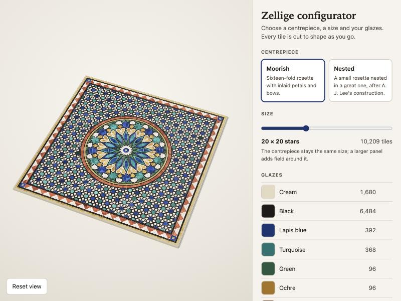
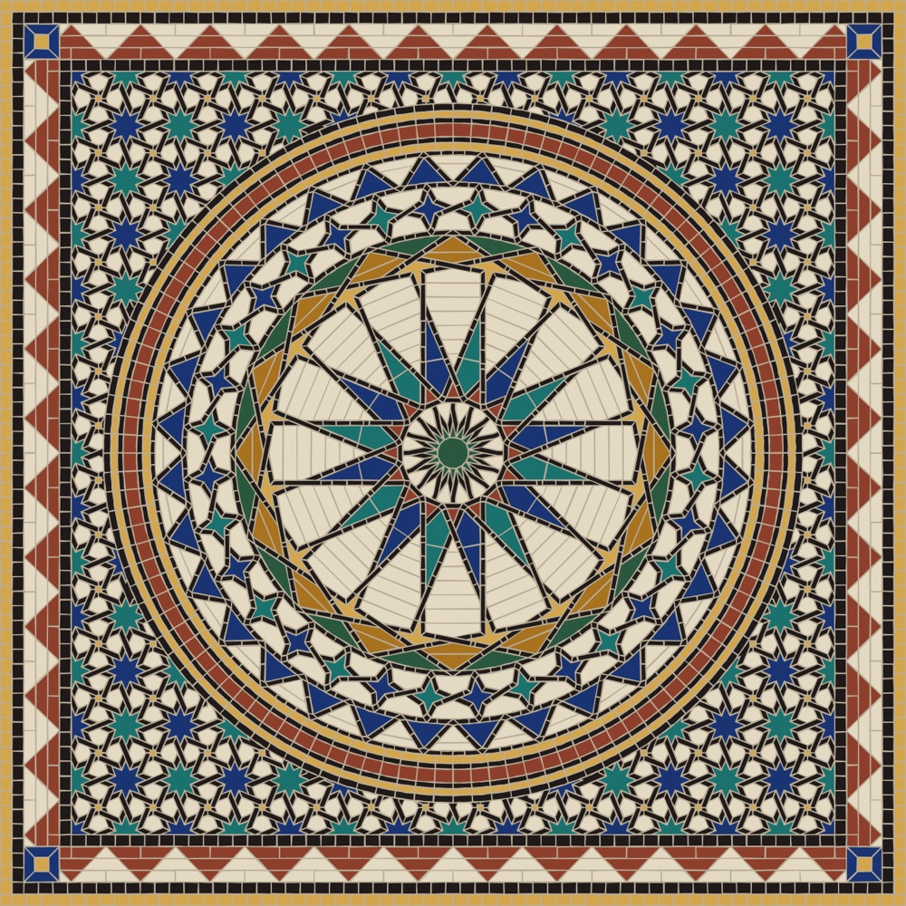
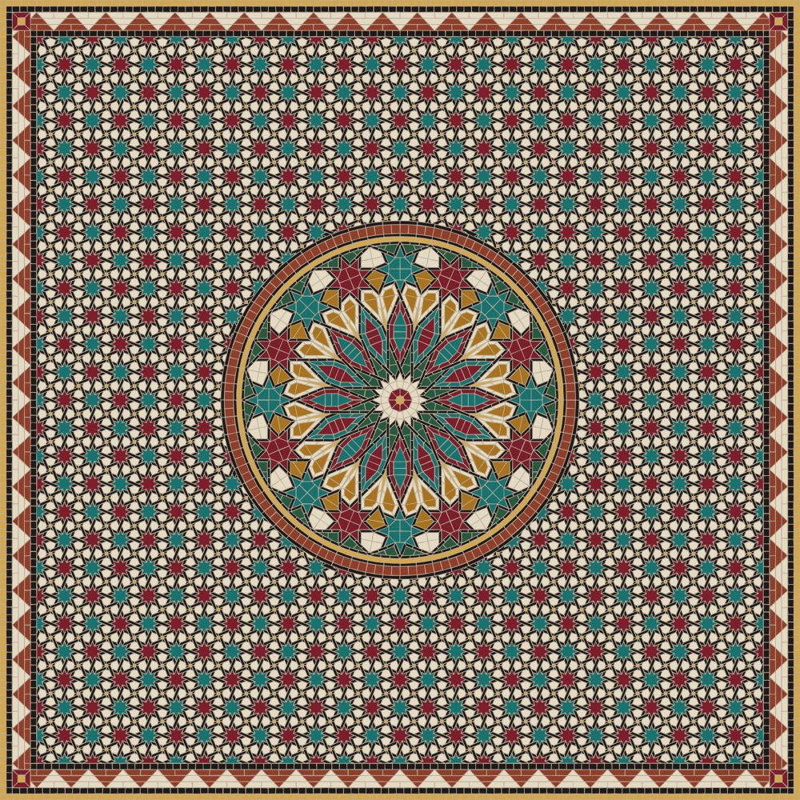

# Zellige configurator

Design a Moroccan zellige panel: choose the pattern, the colours and the size, and get the
tile count a workshop needs to make it.

**Status: milestone 2 of 6.** The pattern engine and the configurator interface work. Sizes in
centimetres, prices and the spec sheet are still to come.



| | |
| --- | --- |
|  |  |
| Nested medallion, the smallest panel (size 7) | Moorish medallion, size 13, with the lapis glaze replaced by red |

## Run it

```bash
npm install
```

```bash
npm run dev
```

## What is here

**`apps/web`** is the configurator: React and TypeScript, with a three.js preview.

- The panel is cut in a web worker, so the page never freezes while ten or twenty thousand
  tiles are generated. Only the latest request waits, so dragging the size slider across five
  sizes cuts two panels, not five.
- Changing a glaze repaints the panel without cutting it again: the mesh records which tile
  each vertex belongs to, and colour is filled in separately.
- The preview draws only when something changes, not sixty times a second.
- The whole design lives in the address (`?size=12&medallion=lee&B=7a1f2b`), so a link
  reproduces it exactly. A broken link opens the nearest valid design.

**`packages/engine`** is the pattern pipeline of
[Rosette in Tesserae](https://github.com/Jameel7007/rosette), lifted out of that piece and
given three options. It is plain JavaScript with no renderer and one dependency
(`polygon-clipping`), so it runs in Node, in a worker, or in a page.

```js
import { buildPanel } from '@zellige/engine';

const panel = buildPanel({ size: 12, medallion: 'lee', palette: { B: '#7a1f2b' } });
panel.pieces;        // every tile: outline, glaze key, region, laying order
panel.stats.byKey;   // how many tiles of each glaze
panel.panel.side;    // side length, in pattern units
```

| Option | Choices | Notes |
| --- | --- | --- |
| `size` | 7 to 16 (default 10) | Half-width of the field in pattern repeats. 4,865 to 26,604 pieces. |
| `medallion` | `moorish`, `lee` | A third design, `polar`, is held back (see below). |
| `palette` | any of the eight glazes, as `#rrggbb` | Changes what a glaze looks like, not which pieces share it. |

With no options, `buildPanel()` returns Rosette's panel exactly: the same 10,209 pieces, to
the last digit.

## What the tests guarantee

For both medallions at all ten sizes (twenty panels), before grout is applied:

- the pieces cover the panel with no gaps and no overlaps (area error under one part in a billion);
- no piece is too small to survive the grout, so there are no holes in the mortar;
- the engine reports no warnings.

Run them with `npm test` (about 40 seconds: 96 engine tests, 15 for the interface's link state,
mesh and colour code).

## Known limits

- **Sizes are whole pattern repeats, and panels are square.** The panel edge has to fall on a
  mirror line of the field, and the border is built as one side turned four times.
- **The medallion does not scale.** It is the same size on every panel, so it fills a size-7
  panel and looks small on a size-16 one.
- **`polar` is not offered.** Its frame rings do not line up exactly and sixteen slivers have
  nowhere to go, so the panel has 160 overlaps and small holes. A test records that defect.
- **No real-world units yet.** Sizes are in pattern units; centimetres and prices come with
  the bill of materials.

## Look at a panel

```bash
node packages/engine/scripts/preview.mjs 12 lee panel.svg B=#7a1f2b
```

## Plan

1. **Engine with size, medallion and palette options** (done)
2. **Configurator interface with a live 3D preview and a shareable link** (done)
3. Bill of materials: count and area per shape and glaze, wastage, price
4. Room view
5. PDF spec sheet, cut plan, quote request
6. Phone layout, accessibility, case study

## Licence

MIT. See [LICENSE](LICENSE).
