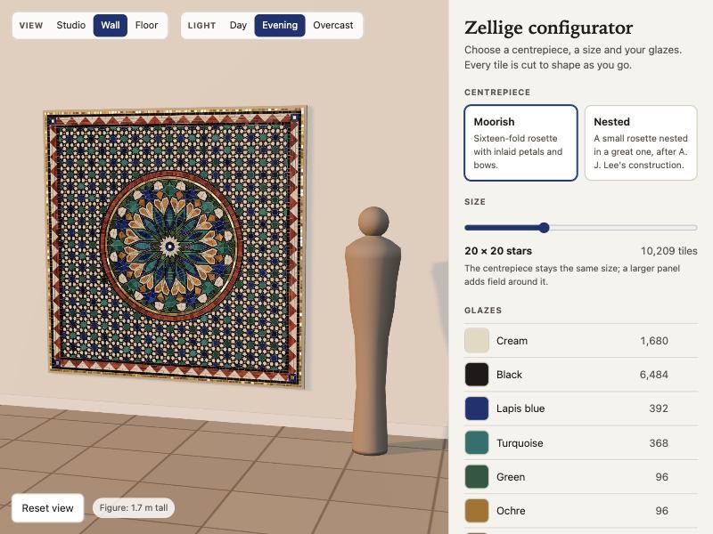
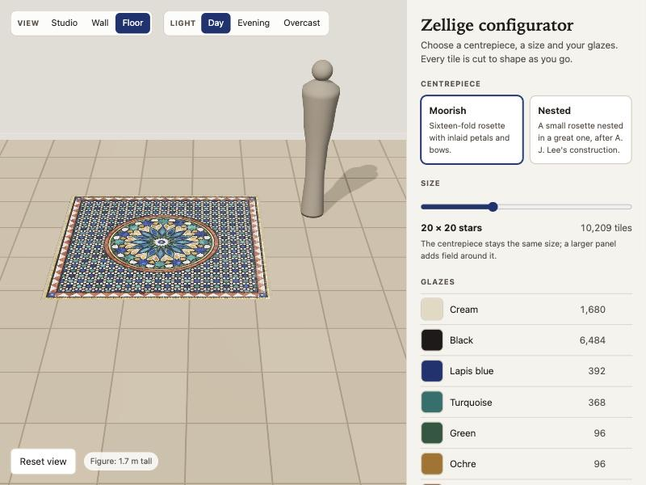
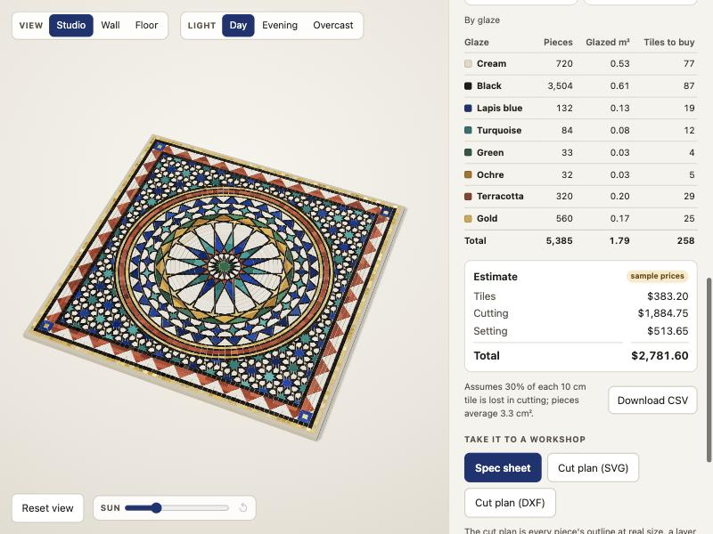

# Zellige configurator

Design a Moroccan zellige panel: choose the pattern, the colours and the size, and get the
tile count a workshop needs to make it.

**Status: all six milestones done.** Read the [case study](docs/case-study.md) for what it
does and why it is built this way.


| | |
| --- | --- |
|  |  |
| Nested medallion, the smallest panel (size 7) | Moorish medallion, size 13, with the lapis glaze replaced by red |

## Run it

```bash
npm install
```

```bash
npm run dev
```

## What is here

**`apps/web`** is the configurator: React and TypeScript, with a three.js preview.

- The panel is cut in a web worker, so the page never freezes while ten or twenty thousand
  tiles are generated. Only the latest request waits, so dragging the size slider across five
  sizes cuts two panels, not five.
- Changing a glaze repaints the panel without cutting it again: the mesh records which tile
  each vertex belongs to, and colour is filled in separately.
- The preview draws only when something changes, not sixty times a second.
- The whole design lives in the address (`?size=12&medallion=lee&scale=2.5&view=wall&B=7a1f2b`), so a
  link reproduces it exactly. A broken link opens the nearest valid design.
- The View control shows the panel alone, hung on a wall or laid in a floor, beside a figure
  1.7 m tall, under day, evening or overcast light. The room is drawn in metres, so changing
  the scale changes how big the panel looks beside the figure.
- The Materials section turns the design into a bill: panel size in metres, pieces to cut and
  square tiles to buy per glaze, a cost estimate, and a CSV with one line per glaze and shape.

**`packages/engine`** is the pattern pipeline of
[Rosette in Tesserae](https://github.com/Jameel7007/rosette), lifted out of that piece and
given three options. It is plain JavaScript with no renderer and one dependency
(`polygon-clipping`), so it runs in Node, in a worker, or in a page.

```js
import { buildPanel } from '@zellige/engine';

const panel = buildPanel({ size: 12, medallion: 'lee', palette: { B: '#7a1f2b' } });
panel.pieces;        // every tile: outline, glaze key, region, laying order
panel.stats.byKey;   // how many tiles of each glaze
panel.panel.side;    // side length, in pattern units
```

| Option | Choices | Notes |
| --- | --- | --- |
| `size` | 7 to 16 (default 10) | Half-width of the field in pattern repeats. 4,865 to 26,604 pieces. |
| `medallion` | `moorish`, `lee` | A third design, `polar`, is held back (see below). |
| `palette` | any of the eight glazes, as `#rrggbb` | Changes what a glaze looks like, not which pieces share it. |

With no options, `buildPanel()` returns Rosette's panel exactly: the same 10,209 pieces, to
the last digit.

## The room view

| | |
| --- | --- |
|  |  |

## How the bill is worked out



```js
import { buildPanel, tallyPieces, billOfMaterials } from '@zellige/engine';

const panel = buildPanel({ size: 10 });
const tally = tallyPieces(panel.pieces);                       // once per panel
const bill = billOfMaterials(tally, { side: panel.panel.side, unitCm: 2 });
bill.totals.sourceTiles;   // 473 ten-centimetre tiles
bill.cost.total;           // 5181.76 (sample prices)
```

- A piece's area is its finished outline, after the grout gap is taken off.
- Tiles to buy, per glaze: glazed area ÷ (1 − wastage) ÷ area of one source tile, rounded up
  to a whole tile.
- Cost: tiles + a cutting charge per piece + a setting charge per square metre of panel.

Counting the pieces and pricing them are separate steps, so changing the scale or the price
table never touches the ten thousand pieces again.

## What the tests guarantee

For both medallions at all ten sizes (twenty panels), before grout is applied:

- the pieces cover the panel with no gaps and no overlaps (area error under one part in a billion);
- no piece is too small to survive the grout, so there are no holes in the mortar;
- the engine reports no warnings.

Run them with `npm test` (about 40 seconds: 110 engine tests, 19 for the interface's link state,
mesh, colour and quote code).

## Taking a design to a workshop

- **Spec sheet.** One page with a drawing of the panel, its size, the glazes with their colour
  codes, the tile counts and the estimate. "Print or save as PDF" opens the browser's print
  dialog, which does both; on paper only the sheet is printed.
- **Cut plan.** Every piece's outline at real size in millimetres, with a group (SVG) or layer
  (DXF) per glaze. The DXF is the R12 dialect: one closed polyline per piece.
  `panelToSvg` and `panelToDxf` in the engine write them.
- **Quote request.** There is no server, so nothing is sent from the page. The request is
  written out as an email in the customer's own mail program, to a placeholder address.

## Phone and keyboard

- Under 820 px wide the preview stays at the top of the screen and its controls (view, light,
  sun) become the first rows of the page under it. On a touch screen every control is at
  least 44 px.
- The preview takes the keyboard: arrow keys turn it, plus and minus zoom, Home puts it back.
- The spec sheet is a dialog: the page behind is inert, Escape closes it, and focus goes back
  to the button that opened it.

## Known limits

- The phone layout and the keyboard were checked in a desktop browser. No real phone and no
  screen reader has been tried yet.

- The DXF is checked by reading it back in the tests (piece count, layers, areas). It has not
  yet been opened in a CAD or cutting program.

- **Sizes are whole pattern repeats, and panels are square.** The panel edge has to fall on a
  mirror line of the field, and the border is built as one side turned four times.
- **No fountain surround.** The room view has a wall and a floor; the fountain setting in the
  original plan was left out.
- **The medallion does not scale.** It is the same size on every panel, so it fills a size-7
  panel and looks small on a size-16 one.
- **`polar` is not offered.** Its frame rings do not line up exactly and sixteen slivers have
  nowhere to go, so the panel has 160 overlaps and small holes. A test records that defect.
- **The bill's figures are assumptions, not a workshop's.** One pattern unit is taken as 2 cm
  (adjustable from 1.5 to 3), pieces are cut from 10 cm tiles, and 30% of each tile is lost in
  cutting. The prices are placeholders, labelled "sample prices" wherever they appear; a real
  price table is one object passed to `billOfMaterials`.

## Look at a panel

```bash
node packages/engine/scripts/preview.mjs 12 lee panel.svg B=#7a1f2b
```

## Plan

1. **Engine with size, medallion and palette options** (done)
2. **Configurator interface with a live 3D preview and a shareable link** (done)
3. **Bill of materials: count and area per shape and glaze, wastage, price** (done)
4. **Room view: wall and floor settings, a scale figure, three lights** (done)
5. **Spec sheet, cut plan, quote request** (done)
6. **Phone layout, accessibility, [case study](docs/case-study.md) and [pitch](docs/pitch.md)** (done)

## Licence

MIT. See [LICENSE](LICENSE).
