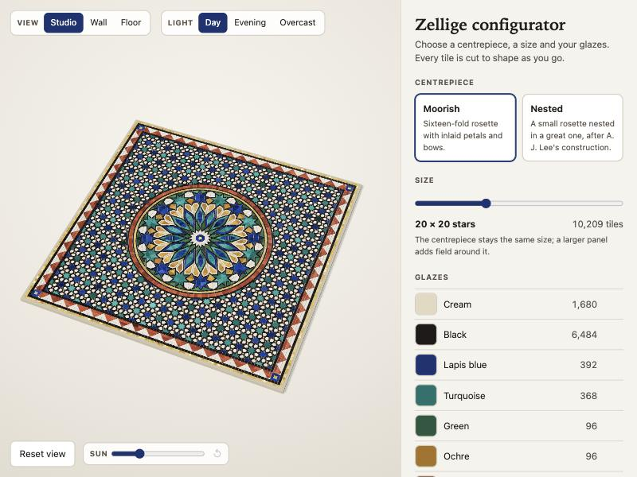

# Case study: a zellige configurator

A customer chooses a centrepiece, a size and eight glazes, sees the panel in 3D on a wall or
in a floor, and leaves with what a workshop needs: a tile count, a cut plan and a spec sheet.

## The problem

Zellige is sold by conversation. A customer describes a panel, the workshop draws it, the
customer asks for the blue to be red, the workshop draws it again and counts the tiles by
hand. Each round takes days, and the price is a guess until the count is done.

A configurator moves that loop to the customer's screen. They try twenty versions in ten
minutes, and the one they send is already counted and drawn.

## What it does

| The customer | The workshop receives |
| --- | --- |
| picks a centrepiece and a size from 7 to 16 | a panel of 4,865 to 26,604 pieces, every one a real cut shape |
| recolours any of the eight glazes | pieces, glazed area and tiles to buy, per glaze |
| views it on a wall or in a floor, and moves the sun | a one-page spec sheet with colour codes |
| copies a link | the exact design, reopened from the link |
| asks for a quote | an email with the design written out, and a cut plan in SVG or DXF at real size |

## Decisions, and why

**The pattern is computed, not drawn.** The panel is not a picture with colour zones. An
engine constructs the star pattern from its geometry, cuts it into pieces, and checks them.
That is why the tile count is exact, and why the same code that draws the preview also writes
the cut plan. The engine came from an earlier piece of mine,
[Rosette in Tesserae](https://github.com/Jameel7007/rosette); here it was lifted out, given
options, and put under test.

**The tests prove the panel can be made.** For both centrepieces at all ten sizes, the tests
check that the pieces cover the panel with no gaps and no overlaps, and that no piece is too
small to survive the grout. A third centrepiece failed that check (160 overlaps) and is held
back rather than offered with a defect.

**The page never freezes.** Cutting twenty thousand pieces takes long enough to notice. That work
runs in a web worker (a second thread), so the sliders stay smooth. Only the latest request
waits in line, so dragging the size slider across five sizes cuts two panels, not five.

**Colour is separate from shape.** The 3D mesh records which tile each corner belongs to.
Changing a glaze repaints the colours and leaves the shapes alone, so a colour change is
instant. Counting pieces and pricing them are separate in the same way: a new scale or price
table is arithmetic, not a new panel.

**The preview draws only when something changes.** Most 3D pages redraw sixty times a second.
This one draws a frame when the customer moves something and then stops, which matters on a
phone battery.

**The design lives in the link.** There are no accounts and no database. The address holds
the whole design (`?size=12&medallion=lee&B=7a1f2b`), so a link in an email reopens exactly
what the customer saw. A damaged link opens the nearest valid design instead of an error.

**No server.** The spec sheet is the browser's own print dialog. The quote is an email
written in the customer's own mail program. The site is static files, so hosting it costs
nothing and there is no customer data to look after.

**The room is in metres.** The wall and the floor are drawn at real size, with 60 cm paving stones,
so the scale setting changes how large the panel looks in the room. A customer can see
whether 2 m of panel suits the wall before paying for it.

## Phone and accessibility

- On a phone the preview stays at the top of the screen and the controls scroll under it.
  Everything a finger presses is at least 44 px.
- Every control works from the keyboard, including the 3D preview: arrow keys turn it, plus
  and minus zoom, Home puts it back.
- Controls are native form elements (radio buttons, range sliders, colour inputs) with
  labels, so a screen reader reads them as what they are. Status messages ("Cutting tiles…",
  "Link copied") are announced.
- The spec sheet opens as a dialog: the page behind it cannot be reached, Escape closes it,
  and focus returns to the button that opened it.
- Text contrast is above 4.5 to 1 throughout. The chosen option keeps an outline in Windows
  high-contrast mode.

## What is not proven yet

I would rather list these than have a client find them.

- **The bill's numbers are my assumptions**, not a workshop's: 2 cm per pattern unit, 10 cm
  source tiles, 30% lost in cutting, placeholder prices (labelled "sample prices" on every
  screen). A real price table is one object in the code.
- **The DXF has not been opened in a CAD or cutting program.** The tests read it back and
  check every piece, but a real machine is the real test.
- **No screen reader test and no real phone test yet.** The accessibility work was checked
  with a keyboard and at phone width in a desktop browser.
- Panels are square, and the centrepiece does not grow with the panel.

## Built with

TypeScript, React 19, three.js, Vite, Vitest; an npm workspace with the engine as its own
package (plain JavaScript, one dependency, runs in Node or a browser). 110 engine tests and
19 interface tests run on every push.

## What a real version needs from a maker

Their patterns, their glaze colours, their tile sizes and wastage, and their price table.
The engine takes each of those as data. See [the pitch](pitch.md).
